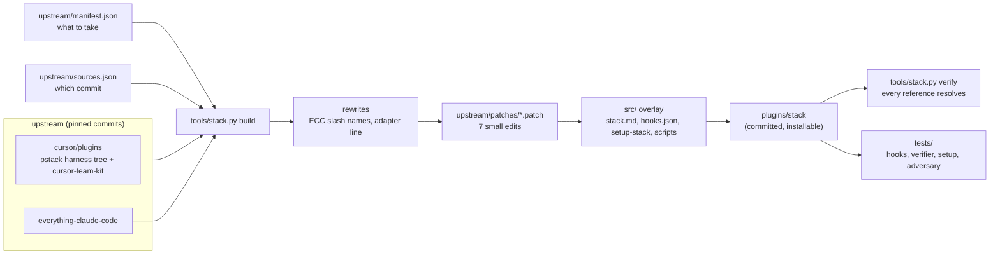

# astack design

## Brief

One Claude Code plugin, `stack`, that gives every coding project two complementary toolkits without their contradictions:

- **pstack** (Lauren Tan, `cursor/plugins`) for judgment, verification, validation and the `poteto-mode` playbooks, plus the cursor-team-kit skills pstack routes to (`deslop`, `control-cli`, `control-ui`, `verify-this` and the CI helpers).
- **ECC** (Affaan Mustafa, Everything Claude Code) for planning, design references, language specialists, security, and deterministic guardrail hooks.

Installed side by side, the two disagree. ECC mandates TDD with 80% coverage and a plan before code. pstack uses TDD only when a test is cheap and does not plan by default. ECC also registers 314 skills and its own memory hooks, which would compete with rewire. `stack` keeps one owner per concern and drops what overlaps.

## Architecture

| Path | Role |
| --- | --- |
| `upstream/sources.json` | Repository and pinned commit for each source |
| `upstream/manifest.json` | The files taken from each source, the ECC command remap, and the hook entry points whose `require` closure is vendored |
| `upstream/patches/` | Edits to vendored files, one patch per file, generated by `tools/stack.py diff` |
| `src/` | Files owned by this repo, copied over the vendored tree. An overlay file may not shadow a vendored one. |
| `plugins/stack/` | Build output, committed so the marketplace can install it. `VENDORED.json` records each file's source and hash. |
| `tools/stack.py` | `build`, `check`, `diff`, `verify` |
| `tests/` | Behavior tests against the built plugin |

## Design

**Integration through the adapter, not through edits.** pstack's Claude Code tree already tells every skill to read one adapter file (`docs/harness/claude-code.md`) that translates Cursor names. `stack` patches that adapter to point at `docs/harness/stack.md`, and `stack.md` carries every integration rule: the ownership table, the plan gate, the model map, external and specialist adversaries, the `gh` to GitHub MCP map, hooks, rules, memory, and the name map. Skills stay close to upstream, so syncing a new upstream commit rarely conflicts.

**One owner per concern.** The table in `stack.md` names the owner of each concern. A skill from the other source is used only in the role the table gives it. ECC's language reviewers, for example, are adversaries inside `interrogate`. They do not give their own verdict.

**Plan gate.** The operator prefers to settle a design before code. `poteto-mode` routes Feature, Refactoring, Multi-phase plan, Orchestrate and `figure-it-out` work through ECC's `/stack:plan` and waits for confirmation. This is the one place `stack` overrides pstack's Never Block on the Human principle. Evidence-driven playbooks (bug fix, perf, forensics) keep pstack's behavior.

**External adversaries.** pstack's `interrogate` depends on models from different families. Claude Code subagents only run Claude models. An `openrouter:<model-id>` panel entry has a non-Claude model propose failures through `scripts/openrouter-adversary.py`, and a Claude executor runs each proposed command. Only a finding whose run shows the failure survives, which is pstack's rule.

**Hooks.** ECC's hook runtime is about 23k lines of interdependent JavaScript. `stack` vendors the `require` closure of the selected entry points rather than rewriting them, registers only guardrails, and runs each through `scripts/stack-hook.js`, which starts the entry point as its own main module and turns off ECC's tracking checks. ECC memory and learning are not shipped.

**Verification as a lever.** `tools/stack.py verify` fails when any skill, agent, command, principle, playbook, relative link or hook script that a shipped file references is missing, unless `stack.md` maps it. It also fails when a shipped file mentions an upstream component that was left out and is not listed under Not shipped. The tests prove the verifier can fail by deleting a routed skill, an agent and a hook script from a copy.

## Decisions

| # | Decision | Why | Rejected |
| --- | --- | --- | --- |
| 1 | New repository, private | The stack is used across every project, not only rewire | A folder inside rewire |
| 2 | Vendor and curate, with a sync script | One coherent plugin with no contradicting instructions, and updates stay mechanical | Installing pstack and ECC side by side plus an overlay plugin, which keeps all 314 ECC skills in context and leaves conflicts to prose |
| 3 | Vendor pstack's generated Claude Code tree, not `pstack/` | It already carries the adapter line in every skill | Re-running pstack's generator here |
| 4 | Patches as unified diffs regenerated from edits | Reviewable in a PR, re-applied on every build, conflicts surface at sync time | Hand-maintained copies |
| 5 | ECC plan gate overrides "never block on the human" for what to build | Matches the operator's preference to settle design first | pstack's no-planning default |
| 6 | ECC `testing.md` rewritten to defer to pstack | Mandatory 80% coverage contradicts Test Behavior, Not Implementation | Shipping both rules |
| 7 | Claude panel `opus` + `sonnet`, OpenRouter optional | Keeps two models with no extra key, and a second model family when a key exists. Fable was refused twice in testing without usage credits, so it is opt-in. | `opus` + `fable` by default, Claude-only, or requiring OpenRouter |
| 8 | No ECC memory, learning, session or cost hooks | rewire owns memory, and two memory systems would double session-start context | Keeping ECC instincts |
| 9 | ECC rules installed on request by `/stack:setup-stack` | Plugins cannot ship always-on rules, and rules cost context in every session | Copying rules into `~/.claude` on install |
| 10 | Plugin name `stack` | Short prefix (`/stack:poteto-mode`) and no clash with an installed `pstack` or `ecc` | Reusing `pstack` |
| 11 | Every code role bound to GLM-5.3-Flash on OpenCode Go, Opus only judges, and a hook enforces it | The operator's choice: one builder model in every harness, and Claude usage spent on evaluation. In the eval, a prose rule alone let Opus write the code itself, so the guard blocks Claude builder spawns and direct edits of repository files while Go is ready. | Opus building small changes itself, which cost less Claude usage in the eval but leaves the builder role unused |
| 12 | The delegate's environment is an allowlist, and `doctor` gates the first run | In a cloud session the child inherited the session's Claude credential and sent it to the Go endpoint. Building the environment instead of inheriting it, and checking it on a local recorder, makes that impossible to miss. | Unsetting known variables, which breaks when Claude Code adds a new one |

## Updating upstream

1. Set the new commit in `upstream/sources.json`.
2. `python3 tools/stack.py build`. A patch that no longer applies stops the build and names the file.
3. Re-make that edit in `plugins/stack`, then `python3 tools/stack.py diff` and `build`.
4. `python3 tools/stack.py verify` and `python3 -m unittest discover -s tests`. New upstream references show up here as missing names. Ship the component, map it in `stack.md`, or list it under Not shipped.
5. `python3 tools/stack.py check` must pass before you commit.

## Flow evals

`evals/flows.py` runs the installed plugin headless on a small CLI app and grades what the agent did: the files it read, the order of its tool calls, the files it changed, the commands it ran as a user, and the hook events. Each run is a real, paid Claude Code session, so the evals run by hand, not in CI.

| Scenario | What it proves | Result on 2026-10-31 |
| --- | --- | --- |
| F1 feature | Restates the goal, reads `stack.md`, writes the plan with `/stack:plan`, stops with no code changed | pass, twice |
| F2 F1 approved | Delegates with the goal in the brief, verifies by running the real CLI, reports evidence | pass |
| F3 bug fix | No plan gate, reproduces before the first edit, commits the failing test before the fix | pass |
| F4 "going to bed" | Records the plan in the decision trail, does not wait, verifies through the CLI | pass after the grant rule was made explicit (run 3) |
| F5 hooks | ECC's Bash preflight blocks `git commit --no-verify` in a live session | pass |

What the evals changed: the plan gate rule was split into "a plan is always written" and "waiting is what a grant removes", Fable left the default panels after it was refused twice, and the eval runs moved outside this repository so its `CLAUDE.md` stops leaking into them.

### GLM-5.3-Flash builder eval (2026-10-31)

Every code role bound to `go:glm-5.3-flash`, Opus as the judge, the role guard on. All 34 checks pass, and every check that grades the finished code was shown to fail on the unchanged or still-buggy app.

| Scenario | Delegate runs | Builder model | Builder time | Opus edits to repository files | Claude cost |
| --- | --- | --- | --- | --- | --- |
| F1 feature, plan gate | 0 (plan only) | | | none | $0.46 |
| F2 approved plan | 2 | glm-5.3-flash | 55 s | none | $0.93 |
| F3 bug fix | 1 | glm-5.3-flash | 38 s | none | $0.55 |
| F4 autonomous | 1 | glm-5.3-flash | 55 s | none | $1.06 |
| F6 tags feature | 2 | glm-5.3-flash | 144 s | none | $1.31 |

For comparison on the same scenarios: a Sonnet subagent builder cost $0.94 (F2) and $1.56 (F6) in Claude usage, and Opus writing the change itself cost $0.47 (F3), $0.35 (F4) and $0.62 (F6). Forcing the Flash builder costs less Claude usage than a Sonnet builder and more than Opus working alone, because Opus still writes the brief, reviews the diff and runs the checks. The guard blocked nothing in these runs: once the exception was gone, `poteto-mode` routed every change to the delegate on its own.
